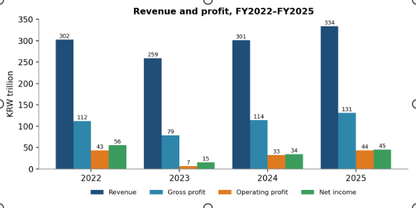
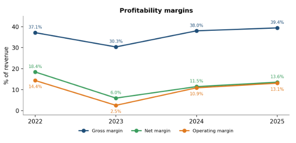
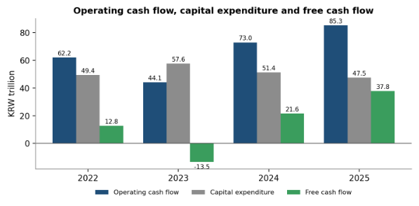
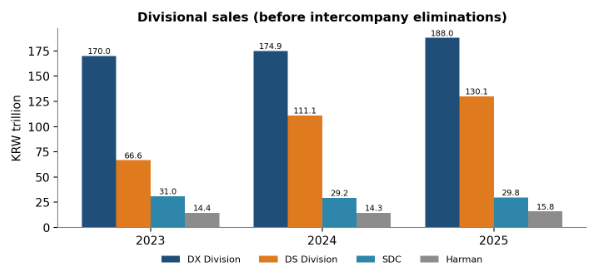
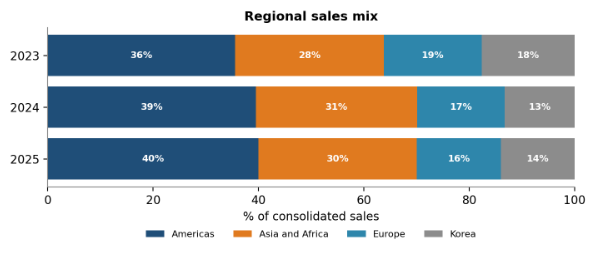

# Samsung Electronics — Financial Analysis Portfolio

## 📊 Project Overview

This project presents a **four-year financial analysis of Samsung Electronics Co., Ltd.** covering FY2022–FY2025.

The purpose of the study is to understand how Samsung's financial performance changed through a period of strong performance, a significant earnings downturn in 2023, and a subsequent recovery.

Rather than looking only at revenue growth, the analysis evaluates the company's:

- Revenue and earnings performance
- Profitability and cost structure
- Cash-flow generation
- Liquidity and financial structure
- Asset and working-capital efficiency
- Business-segment performance
- Geographic sales performance
- Financial vulnerabilities
- Potential management responses

### Central Research Question

> **How did Samsung Electronics' financial performance change between 2022 and 2025, what caused the sharp deterioration in 2023 and subsequent recovery, and what financial and operational vulnerabilities remain despite the recovery?**

The study is **descriptive and diagnostic**. It does not include a company valuation, stock-price target, peer valuation or investment recommendation.

---

# 🎯 Research Objectives

The analysis addresses six major questions:

1. How did Samsung's revenue, gross profit, operating profit and net income change?
2. How did profitability and cost structure evolve?
3. How did liquidity, leverage and efficiency change?
4. How did operating cash flow, capital expenditure and free cash flow behave?
5. Which business divisions and geographic regions drove growth?
6. What vulnerabilities and opportunities can be identified from the financial evidence?

---

# 🏢 Company Background

Samsung Electronics is a Korean multinational electronics and semiconductor company.

The analysis considers four major business divisions:

| Division | Main Business |
|---|---|
| **DX** | TVs, appliances, smartphones and communication systems |
| **DS** | Memory, foundry and system LSI semiconductors |
| **SDC** | Display panels |
| **Harman** | Connected-car systems, audio/video and connected services |

Samsung's exposure to the semiconductor cycle through DS and consumer-electronics demand through DX and SDC makes FY2022–FY2025 a useful period for studying earnings volatility.

---

# 🗂️ Project Structure

```text
Samsung-Electronics-Financial-Analysis/
│
├── README.md
│
├── Data/
│   └── Samsung_Financial_Data.xlsx
│
├── Excel/
│   └── Samsung_Financial_Analysis.xlsx
│
├── Report/
│   └── Samsung_Financial_Analysis_Report.pdf
│
├── Presentation/
│   └── Samsung_Financial_Analysis_Presentation.pptx
│
└── Images/
    ├── revenue-profit.png
    ├── profitability.png
    ├── cash-flow.png
    ├── financial-position.png
    ├── segment-analysis.png
    └── geographic-analysis.png
```

---

# 📅 Analysis Period

**FY2022–FY2025**

All financial amounts are presented in **Korean won (KRW)** unless otherwise stated.

The study uses Samsung's consolidated financial results for the fiscal years ended December 31.

---

# 🛠️ Tools & Techniques

### Software

- **Microsoft Excel** — financial modeling, calculations, ratios, trend analysis and dashboard
- **Microsoft PowerPoint** — research presentation and visualization
- **GitHub** — project documentation and portfolio presentation

### Financial Analysis Techniques

- Common-size financial statement analysis
- Year-over-year growth analysis
- CAGR analysis
- Profitability ratios
- Liquidity ratios
- Leverage analysis
- Efficiency ratios
- Cash-flow analysis
- Segment analysis
- Geographic analysis
- Trend analysis

The Excel workbook contains linked formulas so that calculated figures can be traced back to source inputs.

---

# 📈 1. Revenue & Earnings Performance

Samsung's revenue declined significantly in 2023 before recovering strongly.

| KRW Trillion | 2022 | 2023 | 2024 | 2025 |
|---|---:|---:|---:|---:|
| Revenue | 302.2 | 258.9 | 300.9 | **333.6** |
| Gross Profit | 112.2 | 78.5 | 114.3 | **131.4** |
| Operating Profit | 43.4 | 6.6 | 32.7 | **43.6** |
| Net Income | 55.7 | 15.5 | 34.5 | **45.2** |

Source: Samsung consolidated financial statements; author's calculations.

### Key Finding

The most important observation is that the 2023 downturn was **much more severe in profitability than in revenue**.

From 2022 to 2023:

- Revenue: **−14.3%**
- Operating profit: **−84.9%**
- Net income: **−72.2%**

By 2025:

- Revenue reached **₩333.6T**
- Operating profit recovered to **₩43.6T**
- Net income reached **₩45.2T**

However, net income was still **18.8% below 2022**.

### 📊 Revenue & Profit Trend


```markdown

```

---

# 💹 2. Profitability Analysis

The recovery in gross profitability was stronger than the recovery in operating and net profitability.

| Margin | 2022 | 2023 | 2024 | 2025 |
|---|---:|---:|---:|---:|
| Gross Margin | 37.1% | 30.3% | 38.0% | **39.4%** |
| Operating Margin | 14.4% | 2.5% | 10.9% | **13.1%** |
| Net Margin | 18.4% | 6.0% | 11.5% | **13.6%** |

### Key Finding

Samsung's **2025 gross margin of 39.4% exceeded the 2022 level of 37.1%**.

However:

- Operating margin remained below 2022.
- Net margin remained substantially below 2022.
- Selling and administrative expenses increased faster than revenue.

SG&A increased from **₩68.8T to ₩87.8T**, a **27.5% increase**, while revenue increased only **10.4%**. SG&A as a percentage of revenue therefore increased from **22.8% to 26.3%**.

### Interpretation

This suggests that the main profitability challenge is not simply gross production economics.

The company needs to ensure that the improvement in gross profitability translates into stronger **operating leverage and bottom-line profitability**.

### 📊 Profitability Trend

```markdown

```

---

# 💰 3. Cash Flow Analysis

Free cash flow was highly volatile during the study period.

| KRW Trillion | 2022 | 2023 | 2024 | 2025 |
|---|---:|---:|---:|---:|
| Operating Cash Flow | 62.2 | 44.1 | 73.0 | **85.3** |
| Capital Expenditure | 49.4 | 57.6 | 51.4 | **47.5** |
| Free Cash Flow | 12.8 | **−13.5** | 21.6 | **37.8** |

Free cash flow in this study is calculated as:

> **Operating Cash Flow − Acquisition of PP&E**

Intangible-asset purchases are excluded from this simplified FCF calculation.

### Key Finding

2023 was a major cash-flow pressure year because capital expenditure exceeded operating cash generation.

By 2025:

- Operating cash flow reached **₩85.3T**
- CapEx declined to **₩47.5T**
- Free cash flow increased to **₩37.8T**

This represents a substantial improvement from the **−₩13.5T** FCF recorded in 2023.

### 📊 Cash Flow Trend

```markdown

```

---

# 🏦 4. Liquidity & Financial Structure

| Metric | 2022 | 2025 | Direction |
|---|---:|---:|---|
| Current Ratio | 2.79x | **2.33x** | ↓ |
| Quick Ratio | 2.12x | **1.83x** | ↓ |
| Liabilities / Equity | 26.4% | **29.9%** | ↑ |

### Key Finding

Samsung remains financially strong in absolute terms, but its liquidity cushion has gradually narrowed.

The current ratio declined from **2.79x to 2.33x**, while liabilities-to-equity increased from **26.4% to 29.9%**.

This should be interpreted as an **efficiency and cushion issue rather than a liquidity crisis**.

The analysis does not classify liabilities as interest-bearing debt because the workbook did not separately extract borrowings. Therefore, the leverage measures are based on total liabilities.

---

# ⚙️ 5. Asset & Working-Capital Efficiency

One of the more important warning signals is that the company's asset base and receivables expanded faster than revenue.

### 2022 → 2025

- Total assets: **+26.4%**
- Trade receivables: **+43.1%**
- Revenue: **+10.4%**
- Asset turnover: **0.67x → 0.59x**
- Receivables turnover: **8.46x → 6.52x**


### Interpretation

Samsung has increased the amount of capital tied up in assets and receivables faster than its revenue base has expanded.

This does **not automatically indicate collection problems**, because year-end balances can be affected by timing. The report therefore treats receivables as a **watch item rather than evidence of collection failure**.

### 📊 Asset & Receivables Trend

```markdown

```

---

# 🧩 6. Business-Segment Analysis

The analysis identifies an increasingly important role for the **Device Solutions (DS)** division.

### 2023 → 2025 Sales Growth

| Division | Sales Growth |
|---|---:|
| **DS** | **+95.3%** |
| DX | +10.6% |
| Harman | +9.7% |
| SDC | **−3.9%** |

DS's share of divisional sales increased from **23.6% to 35.8%**.

### Key Interpretation

The recovery has become increasingly **semiconductor-led**.

This is positive because DS is a major growth driver, but it also means that Samsung's earnings recovery remains exposed to semiconductor-cycle conditions.

Meanwhile, SDC has not participated in the recovery to the same degree.

### Important Data Note

Divisional sales are reported before intercompany eliminations. Therefore, divisional totals should **not** be directly compared with consolidated revenue without considering the reconciliation.

### 📊 Segment Analysis

```markdown

```

---

# 🌎 7. Geographic Analysis

The analysis also examined regional sales.

### 2023 → 2025

| Region | 2023 | 2025 | Growth |
|---|---:|---:|---:|
| Americas | ₩92.1T | **₩133.3T** | **+44.7%** |
| Asia & Africa | ₩73.1T | **₩100.4T** | **+37.3%** |
| Europe | ₩48.1T | ₩53.3T | +10.8% |
| Korea | ₩45.6T | ₩46.6T | +2.2% |

The Americas represented approximately **40.0% of 2025 regional sales**, while Asia & Africa represented approximately **30.1%**.

### Interpretation

Growth has been concentrated more heavily in the **Americas and Asia & Africa**, while Korea and Europe have grown more slowly.

This provides an additional geographic dimension to the company's growth analysis.

### 📊 Geographic Sales

```markdown

```

---

# ⚠️ 8. Key Financial Shortcomings Identified

The analysis identifies several areas requiring continued attention.

### 1. Earnings cyclicality

The 2023 results demonstrate how sharply operating profit can decline when revenue and business conditions deteriorate.

### 2. Rising cost intensity

SG&A increased **27.5%**, considerably faster than revenue growth of **10.4%**.

### 3. Incomplete bottom-line recovery

2025 operating profit was approximately back to 2022 levels, but net income remained **18.8% below 2022**.

### 4. Narrowing liquidity cushion

Current and quick ratios declined from 2022 levels.

### 5. Lower asset productivity

Assets grew significantly faster than revenue, reducing year-end asset turnover.

### 6. Receivables growth

Trade receivables increased **43.1%**, considerably faster than revenue.

### 7. Semiconductor concentration

The recovery became increasingly dependent on DS.

### 8. SDC stagnation

SDC sales declined **3.9% between 2023 and 2025**.

These findings are consistent with the report's overall conclusion that Samsung's 2025 financial position is strong, but sustainability and resilience remain important analytical questions.

---

# 💡 9. Proposed Solutions

The recommendations below are **analytical proposals derived from the financial evidence**, rather than claims about Samsung's actual adopted strategy.

## Solution 1 — Improve Earnings Resilience

**Problem addressed:** semiconductor cyclicality and incomplete earnings recovery.

### Proposed actions

- Increase exposure to higher-value semiconductor products.
- Develop non-memory semiconductor opportunities.
- Increase recurring/service revenue in DX and Harman.
- Maintain greater flexibility in the operating-cost structure.
- Monitor operating and non-operating contributions to net income separately.

**Primary KPI:**

> Operating Margin

---

## Solution 2 — Strengthen Working-Capital Management

**Problem addressed:** receivables growth and narrowing liquidity cushion.

### Proposed actions

- Track Days Sales Outstanding (DSO).
- Analyze receivables ageing.
- Review customer credit conditions.
- Review payment terms where receivables growth exceeds sales growth.
- Monitor inventory together with receivables.
- Establish internal liquidity thresholds.

**Primary KPI:**

> Receivables Turnover / DSO

The report specifically proposes customer- and region-level DSO tracking and receivables ageing to distinguish genuine collection deterioration from year-end timing effects.

---

## Solution 3 — Improve Capital Allocation & Cost Discipline

**Problem addressed:** asset growth exceeding revenue growth and elevated SG&A intensity.

### Proposed actions

- Evaluate major capital investments against expected cash-flow returns.
- Monitor capacity utilisation after investment.
- Improve asset utilisation.
- Distinguish growth-generating expenditure from overhead.
- Track operating leverage.

**Primary KPIs:**

> Free Cash Flow / CapEx  
> Asset Turnover  
> SG&A / Revenue

---

## Solution 4 — Strengthen Slower-Growing Businesses

**Problem addressed:** SDC's weaker sales growth and increasing concentration of recovery in DS.

### Proposed actions

- Prioritise higher-growth display applications.
- Strengthen premium display positioning.
- Improve premium product mix within DX.
- Expand ecosystem and service economics.
- Allocate capital according to business-level profitability and growth potential.

**Primary KPI:**

> Segment Growth + Segment Profitability

The report identifies higher-value display applications and premium DX/ecosystem economics as analytical response areas.

---

# 📊 10. Analyst Monitoring Dashboard

The historical analysis can be converted into a forward-looking monitoring framework.

| Area | 2025 Position | What to Monitor |
|---|---:|---|
| **Earnings** | Operating margin: **13.1%** | Movement toward 14.4% 2022 level |
| **Cash** | FCF: **₩37.8T** | Cash generation vs planned investment |
| **Liquidity** | Current ratio: **2.33x** | Direction and internal liquidity buffer |
| **Working Capital** | Receivables turnover: **6.52x** | DSO and receivables ageing |
| **Business Mix** | DS: **35.8%** of divisional sales | Semiconductor concentration |
| **Growth** | SDC: **₩29.8T** | Evidence of renewed growth |

This transforms the portfolio from a historical financial report into a **repeatable analyst monitoring framework**.

---

# 🔍 11. Methodology

The Excel model uses:

### Financial Statement Analysis

- Income statement
- Balance sheet
- Cash-flow statement

### Ratio Analysis

**Profitability**

```text
Gross Margin = Gross Profit / Revenue

Operating Margin = Operating Profit / Revenue

Net Margin = Net Income / Revenue
```

**Liquidity**

```text
Current Ratio = Current Assets / Current Liabilities

Quick Ratio =
(Current Assets − Inventories) / Current Liabilities
```

**Efficiency**

```text
Asset Turnover = Revenue / Total Assets

Receivables Turnover =
Revenue / Trade Receivables
```

**Cash Flow**

```text
Free Cash Flow =
Operating Cash Flow − PP&E Purchases
```

**Growth**

```text
YoY Growth =
(Current Year − Previous Year) / Previous Year

CAGR =
(Ending Value / Beginning Value)^(1/n) − 1
```

The report documents these definitions and treatment decisions, including the use of year-end balances for the primary four-year ratio comparison.

---

# 📁 12. Project Files

### 📊 Financial Analysis Workbook

The Excel workbook contains the underlying financial data, calculations, ratios, growth analysis and dashboard.

**[View Excel Analysis](Excel/Samsung_Financial_Analysis.xlsx)**

### 📄 Research Report

The complete written analysis explains the methodology, findings, limitations and recommendations.

**[Read Full Research Report](Report/Samsung_Financial_Analysis_Report.pdf)**

### 📈 Presentation

The PowerPoint summarizes the research findings and recommendations in presentation format.

**[View Presentation](Presentation/Samsung_Financial_Analysis_Presentation.pptx)**

### 📂 Data

**[View Supporting Data](Data/Samsung_Financial_Data.xlsx)**

---

# 📚 Data Sources

The primary sources used in the analysis are:

- Samsung Electronics Investor Relations financial statements
- Samsung Sustainability Facts & Figures
- Samsung's published consolidated financial disclosures

The report states that headline figures are traceable to the supplied workbook and source financial statements.

---

# ⚠️ Limitations

This study has several limitations:

- The analysis covers only four fiscal years.
- No peer-company benchmarking is included.
- No stock valuation or price target is calculated.
- No forward financial forecast is included.
- Primary ratios use year-end balances.
- Divisional sales are presented before intercompany eliminations.
- The simplified FCF calculation excludes intangible-asset purchases.
- Borrowings were not separately extracted; leverage therefore uses total liabilities rather than interest-bearing debt.

These limitations are explicitly documented in the research methodology.

---


# 👩‍💼 Skills Demonstrated

This project demonstrates practical skills in:

- Financial statement analysis
- Excel financial modeling
- Financial ratio analysis
- Data cleaning and organization
- Trend analysis
- Business-segment analysis
- Geographic analysis
- Cash-flow analysis
- Financial interpretation
- Data visualization
- Research writing
- Presentation development
- Evidence-based recommendation building

---

# 📌 Final Research Conclusion

Samsung's 2025 financial position is **strong**, particularly when compared with the severe earnings deterioration experienced in 2023.

Operating profit recovered to approximately its 2022 level, gross margin exceeded the 2022 level, and free cash flow reached **₩37.8T**.

However, the recovery is not complete.

Operating margin remains below 2022, net income is still below its 2022 level, SG&A has grown faster than revenue, liquidity ratios have declined, and asset and receivables growth have outpaced revenue.

At the business level, the recovery has also become increasingly semiconductor-led, increasing the importance of managing cyclicality.

### Overall Research View

> **Samsung's financial recovery is substantial, but the next challenge is sustainability: improving earnings resilience, controlling cost intensity, increasing working-capital and asset productivity, and strengthening slower-growing businesses.**

**This project is an academic/student equity-research portfolio and does not constitute investment advice.**
